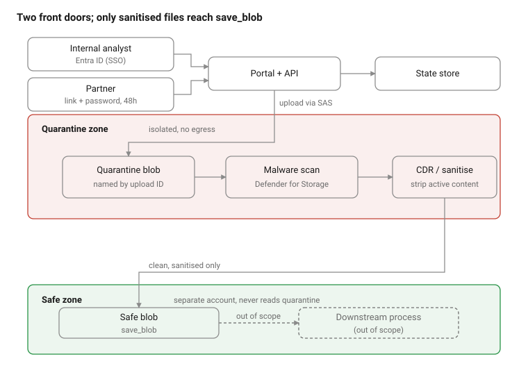

# Azure Sheep Dip — Secure File Transfer Design

_Last updated: 12 October 2026_

## Purpose and scope

A secure file-ingestion service (a "sheep dip") that lets an external sender upload a file through a one-time link, scans it for malware at rest, and releases only clean files to a trusted side for processing. The dirty and clean sides never share trust.

In scope:

- A portal that issues single-use upload links, each with its own ID.
- Direct-to-storage upload into an isolated quarantine zone.
- Malware scanning at rest, with a clean verdict required before release.
- Automated move of clean files to a separate trusted store, then processing.

Out of scope for this version: sender identity/authentication beyond the link, content disarm and reconstruction (CDR), and the downstream processing logic itself (treated as a trusted-side consumer).

## Architecture overview

The sender never touches the trusted side: a file crosses from quarantine to trusted only after a clean scan verdict. A malicious verdict routes the file to quarantine or deletion and raises an alert.

## Components

| Component | Azure service | Role |
| --- | --- | --- |
| Portal + API | App Service or Static Web App + Azure Functions | Issues one-time links, validates them, mints upload SAS tokens |
| State store | Table Storage or Cosmos DB | One record per upload: ID, expiry, status (pending → uploaded → scanned → clean/blocked) |
| Quarantine store | Storage account (Blob), isolated | Holds untrusted files at rest, named by upload ID; no public access, no egress |
| Scanner | Defender for Storage (malware scanning) or custom engine | Full malware scan on upload, writes a verdict |
| Verdict router | Event Grid + Azure Function | Reads the verdict; moves clean files out, quarantines or deletes the rest |
| Trusted store | Separate storage account (Blob) | Holds released clean files; never reads from quarantine |
| Processing | Function / container / app | Consumes clean files on a trusted-side event |

The upload flow in brief:

1. Sender opens the link; the API checks the ID exists, has not expired, and is unused.
2. The API returns a short-lived, write-only SAS scoped to one blob in the quarantine container.
3. The browser uploads directly to Blob storage — the app never handles the file bytes.
4. Scanning runs at rest; the verdict router acts on the result.

## Security and isolation

The design rests on a hard boundary between the dirty and clean sides.

- **Upload SAS** — write-only, scoped to a single blob, short time-to-live, tied to the upload ID. This is the trust boundary at upload: a leaked link cannot be used to list or read the container, only to write its one blob once.
- **Quarantine network lockdown** — public blob access disabled, reached only over private endpoints, with no outbound egress from the zone.
- **Separate storage accounts** — quarantine and trusted data live in different accounts with different managed identities and RBAC. The trusted side has no read path into quarantine.
- **One-way promotion** — only the verdict router can copy a file from quarantine to trusted, and only after a clean verdict. Blocked files are quarantined or deleted, never released.
- **End-to-end logging** — every upload, verdict and move is logged with its upload ID, giving a full audit trail from link issue to processing.

## Malware scanning: Defender for Storage vs custom engine

Two routes. [Defender for Storage](https://learn.microsoft.com/en-us/azure/defender-for-cloud/defender-for-storage-introduction) is the low-effort default: a configurable add-on that runs a full scan on upload in near real time, powered by Microsoft Defender Antivirus, with no infrastructure to manage. A custom engine (an AV engine in a Function or container) is the route when you need multiple engines, CDR, or scanning of files larger than Defender's per-blob limit — at the cost of building and running it.

### Defender for Storage — current limits

| Limit | Value |
| --- | --- |
| Per-blob scan size | Up to 2 GB per file |
| Default monthly cap | 10,000 GB (10 TB) scanned per storage account per month |
| Behaviour at cap | Scanning halts for the rest of the month (≈20 GB confidence interval); configurable via `CapGBPerMonthPerStorageAccount`, set to `-1` for unlimited |
| Scan throughput | Up to 50 GB per minute per storage account |
| Supported storage | Azure Blob Storage only |
| Trigger | On upload (near real time), or on-demand |

Sources: [malware scanning limits and cap](https://learn.microsoft.com/en-us/azure/defender-for-cloud/on-upload-malware-scanning), [cap configuration](https://learn.microsoft.com/en-us/azure/defender-for-cloud/defender-for-storage-powershell-enablement), [2 GB per-file limit](https://www.ithome.com.tw/review/164007).

### Pricing

Defender for Storage has two charges: a per-storage-account plan fee, plus malware scanning billed per GB scanned. Microsoft's [pricing page](https://azure.microsoft.com/en-us/pricing/details/defender-for-cloud/) does not render the figures as plain text, so the amounts below are approximate ballparks — confirm current rates for your region (UK South) in the [Azure pricing calculator](https://azure.microsoft.com/en-us/pricing/calculator/?service=defender-for-cloud) before budgeting.

| Charge | Approximate rate |
| --- | --- |
| Defender for Storage plan | ~$10 per storage account per month |
| Malware scanning | ~$0.15 per GB scanned |

Billing notes (sourced): malware scanning is **not** free during the first 30-day trial — it is charged from day one; it supports Azure Blob Storage only; and it is not available on Defender for Storage (classic). The monthly cap is the main cost control — set it per storage account to bound spend. ([pricing page](https://azure.microsoft.com/en-us/pricing/details/defender-for-cloud/))

Cost sketch: at ~$0.15/GB, scanning 1 TB of uploads in a month is roughly $150 in scanning, plus the ~$10 account fee. Large files are the cost driver — the per-blob 2 GB limit and the monthly cap both bound exposure.

## Operational considerations

- **Link lifecycle** — links are single-use and expire; the state store enforces one upload per ID and rejects reuse. Expired or unused records are cleaned up on a schedule.
- **Blocked files** — on a malicious verdict, the router quarantines or deletes the blob, marks the ID `blocked`, and raises an alert. Clean-up of quarantined malicious files follows a retention policy.
- **Large files** — files above Defender's 2 GB per-blob limit are not scanned by Defender; decide whether to reject them at upload (size filter on the SAS/portal) or route them to the custom-engine path.
- **Monitoring** — alert on the monthly scanning cap approaching its limit (scanning silently halts once reached), on blocked-file events, and on files stuck in `pending`/`uploaded` beyond an expected window.
- **Cost control** — set the per-account monthly cap deliberately; it is the primary guardrail against runaway scanning spend.

## Open decisions

- [ ] Scanner choice: Defender for Storage (simple, single-engine, 2 GB per-file cap) vs a custom multi-engine/CDR engine.
- [ ] Maximum accepted file size, and how files over 2 GB are handled.
- [ ] Sender authentication — is the one-time link sufficient, or is an identity check needed before a link is issued?
- [ ] Retention periods for quarantined (clean and malicious) files.
- [ ] Any accreditation or assurance constraints that limit which Azure components are permitted.

## Acronyms

| Acronym | Meaning |
| --- | --- |
| API | Application Programming Interface |
| AV | Antivirus |
| CDR | Content Disarm and Reconstruction |
| DB | Database |
| GB | Gigabyte |
| ID | Identifier |
| RBAC | Role-Based Access Control |
| SAS | Shared Access Signature |
| TB | Terabyte |
